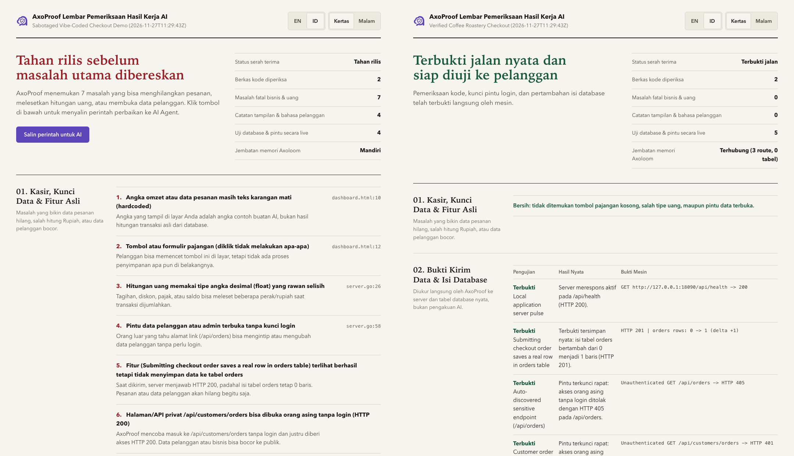

<p align="center">
  
</p>

<h3 align="center">
  Independent Runtime Proof, Money/Privacy Inspector, Structural Anti-Slop Filter,<br>
  and SHA-256 Sealed Owner Receipt Skill for AI Coding Agents.
</h3>

<p align="center">
  <a href="./LICENSE"></a>
  
  
  <a href="https://github.com/r17v/axoloom"></a>
</p>

<p align="center">
  
</p>

An Agent Skill and zero-dependency Python 3.10+ standard-library inspector that stops AI coding agents from claiming *"Done! Build passed!"* when buttons are fake, money math uses floats, private API routes are unlocked, or nothing is actually saved to the database. Free, MIT, no signup, no API key, nothing to `pip install`, nothing to compile.

---

## Install

### Universal Agent Skills CLI (`Antigravity`, `Claude Code`, `Cursor`, `Codex`, `Windsurf`)

```bash
npx skills add r17v/axoproof
```

### Claude (Paste Link)

Paste this repository link into Claude and say `install skill`:

```text
https://github.com/r17v/axoproof

install skill
```

### Claude Code Plugin Marketplace

```text
/plugin marketplace add r17v/axoproof
/plugin install axoproof@axoproof
```

### Direct Git Clone (Global or Project-Local)

```bash
# Antigravity / Universal ~/.agents/skills
git clone https://github.com/r17v/axoproof.git ~/.agents/skills/axoproof

# Or Claude Code ~/.claude/skills
git clone https://github.com/r17v/axoproof.git ~/.claude/skills/axoproof
```

Requires **Python 3.10 or newer** (standard library only: `sqlite3`, `urllib.request`, `hashlib`, `json`, `subprocess`). Zero external packages.

---

## Why AxoProof Exists

An AI coding agent grading its own work has a conflict of interest. Non-technical founders, agency owners, and fast-moving builders routinely get handed fragile facades:

- **Placebo Interfaces:** Buttons that show a green success toast while writing `0` rows to the database, `.skip` tests silenced to turn CI green, or dashboard cards displaying hardcoded `$18,500.00` sample figures.
- **Cash-Register Bugs:** Floating-point rounding drift on currency, negative-quantity exploits (`quantity: -5`), or checkout endpoints trusting item prices sent straight from the buyer's browser.
- **Unlocked Customer Doors:** Sensitive `/api/customers` or `/api/orders` endpoints exposed without authentication, raw SQL string interpolation, or secret keys leaked into `NEXT_PUBLIC_*` / `VITE_*` client bundles.
- **Customer-Screen AI Slop:** Leftover `support@example.com` contacts, fabricated `"Trusted by 10,000+ users"` claims, dead `href="#"` links, raw stack traces, and cramped `<44px` mobile buttons.

**AxoProof** separates the **Inspector** from the **Builder**: one compact root `SKILL.md` (`26` lines) progressively loads **6 specialist modules** only when needed, and `scripts/axoproof.py` executes counterfactual live HTTP + database probes before stamping a SHA-256 sealed **`.axoproof/RECEIPT.html`** dossier that the AI cannot forge.

---

## 1 Skill Door, 6 Specialist Modules Inside

| Module | What It Guards | Receipt Track |
| :--- | :--- | :--- |
| `modules/no-placebo.md` | Stops empty `onClick` handlers, simulated `setTimeout` saves, hardcoded fake KPI figures, and `.skip` tests | **Fatal Business Risk** |
| `modules/cash-register.md` | Enforces integer minor-unit currency (`int64` / `BIGINT` cents / `NUMERIC`), server-side price lookup, and negative-quantity rejection | **Fatal Business Risk** |
| `modules/door-locks.md` | Verifies authentication on private routes, blocks raw SQL string concatenation, and catches exposed client secrets | **Fatal Business Risk** |
| `modules/live-persistence.md` | Auto-starts your server, counts real SQLite rows (`0 -> 1`) or verifies Postgres/Supabase HTTP read-back, and checks `375px` mobile DOM renders | **Live Runtime Proof** |
| `modules/customer-ready.md` | Catches `example.com` / fake social proof, dead `#` links, leaked stack traces, brochure cliches, `<44px` buttons, plus runs an isolated *Fresh-Eyes Customer Critic* pass | **Customer Polish Track** |
| `modules/self-repair.md` | Forces the AI agent to repair `[BLOCKING]` defects autonomously (up to 3 rounds) before handing the receipt to the owner | **Autonomous Repair** |

---

## Native 2-Way Bridge with [Axoloom](https://github.com/r17v/axoloom)

`Axoloom` (Go/MCP codebase AST + vault engine) and `AxoProof` (Python stdlib runtime verifier) share SQLite natively with zero glue dependencies:

1. **Upstream (`Axoloom` -> `AxoProof`):** Before coding, the agent boots real business facts, brand voice, and permanent guardrails from `Axoloom`. During `verify`, `scripts/axoproof.py` opens `.axoloom/index.db` in read-only SQLite mode to auto-discover sensitive `/api/*` endpoints (even if omitted from `claims.json`) and expand `--scope diff` across 1-hop upstream callers.
2. **Downstream (`AxoProof` -> `Axoloom`):** Passing `--sync-axoloom` writes the SHA-256 sealed verification summary back into `Axoloom` handoff memory so every future agent session inherits what was proven.

---

## Try the 1-Command Live Demo

Run a self-contained comparison between a sabotaged vibe-coded store (`HOLD_RELEASE`, catching fake saves, float pricing, unlocked customer orders, and negative-quantity exploits) and a repaired store (`SAFE_TO_TEST`, proving `0 -> 1` SQLite row persistence):

```bash
python3 scripts/axoproof.py demo
```

Pass `--open` if you want to inspect the generated Swiss archival `.axoproof/RECEIPT.html` dossier (with instant **EN / ID** and **Paper / Night** switches) in your browser:

```bash
python3 scripts/axoproof.py demo --open
```

---

## Three Output Surfaces, Zero Uninvited Browser Popups

1. **Terminal / SSH / Termux (`--format table`, default):** Prints a 74-column structured inspection ledger directly in stdout with plain-language findings, live HTTP/database measurements, and SHA-256 seal.
2. **AI Coding Harnesses (`--format markdown`):** Emits a compact 3-row Markdown table with a clickable `file://` link to `.axoproof/RECEIPT.html` so chat stays clean and token-lean.
3. **Archival Browser Dossier (`--open` or click the link):** Opens the Swiss editorial inspection sheet with 1-click **"Copy AI repair brief"** and clean print/PDF handover layout.

---

## CLI Reference

```bash
python3 scripts/axoproof.py init       [--dir <path>]
python3 scripts/axoproof.py verify     [--dir <path>] [--claims <path>] [--scope all|diff] [--lang en|id] [--format table|markdown|json] [--sync-axoloom] [--open]
python3 scripts/axoproof.py check-seal [--dir <path>] [<receipt.json>]
python3 scripts/axoproof.py demo       [--open]
python3 scripts/axoproof.py version
```

- Exit code `0`: `SAFE_TO_TEST` or `LOCAL_ONLY_MANUAL_CHECK`
- Exit code `2`: `HOLD_RELEASE` (blocks premature agent completion or CI merge; also returned when seal verification detects tampering)

## Repository Layout

```text
axoproof/
├── SKILL.md                  # 26-line progressive-disclosure entrypoint
├── modules/                  # 6 on-demand specialist inspection protocols
├── scripts/
│   └── axoproof.py           # Zero-dependency Python 3.10+ stdlib engine
├── tests/
│   └── test_axoproof.py      # Counterfactual probe, scanner, bridge & seal tests
├── assets/                   # Brand vectors & Swiss dossier showcase
└── .claude-plugin/           # Claude Code marketplace metadata
```

## License

MIT License. See [LICENSE](./LICENSE).
